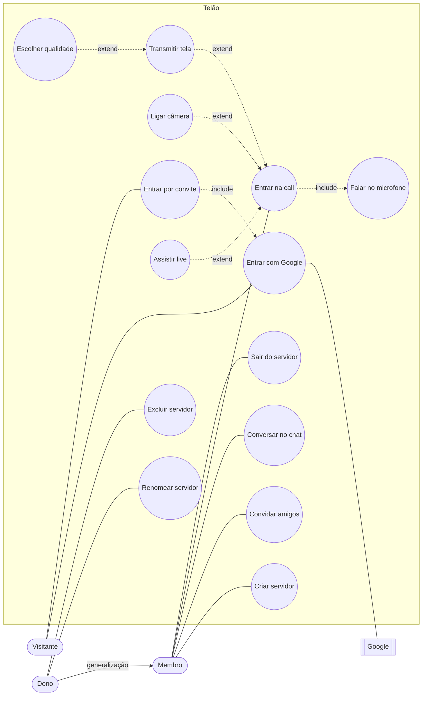
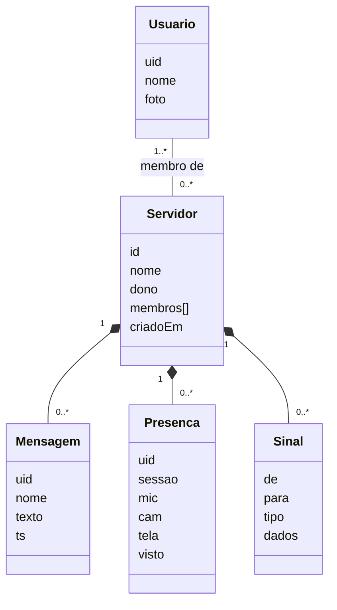
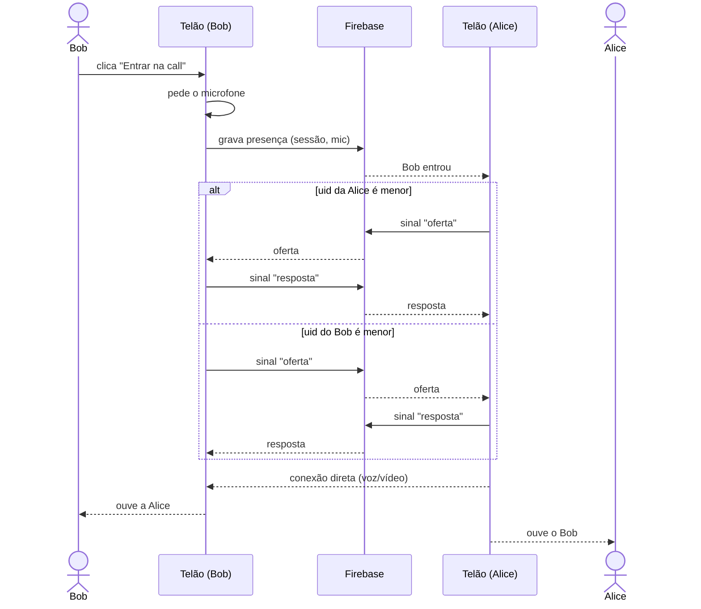
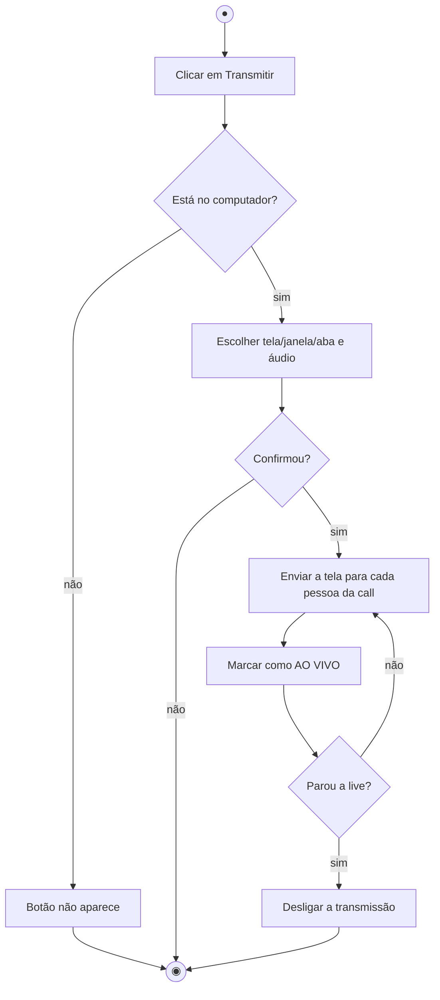

# Telão — Documento de Requisitos

**Versão:** 1.0 · **Autor:** Davi (wasmorf) · **Data:** 14/11/2026

## 1. Visão geral

O Telão é um site particular, no estilo Discord, para um grupo de amigos conversar por texto, voz e câmera e **transmitir a tela ao vivo**. Ele surgiu porque o compartilhamento de tela do Discord ficou indisponível no Brasil em 2026.

- **Problema:** o grupo não tinha onde fazer live de tela pra assistir junto.
- **Solução:** um site gratuito, hospedado no GitHub Pages, usando Firebase (login e banco) e WebRTC (voz e vídeo direto entre as pessoas).
- **Público:** o autor e os amigos dele (não é um serviço público).

### Técnicas de elicitação usadas
- **Observação de produto existente:** estudo de como o Discord organiza servidores, canais e call.
- **Entrevista não estruturada:** conversa com o usuário sobre o que faltava (tela, call, login com Google, funcionar no celular).
- **Prototipação evolutiva:** cada versão do site foi mostrada e ajustada (cor laranja, logo, layout mais simples).

## 2. Atores

| Ator | Descrição |
|---|---|
| **Visitante** | Pessoa que abriu o site mas ainda não entrou com o Google. |
| **Membro** | Pessoa logada que faz parte de um servidor. |
| **Dono** | Membro que criou o servidor (herda tudo do Membro). |
| **Google** (sistema externo) | Autentica as pessoas. |
| **Firebase** (sistema externo) | Guarda servidores, mensagens e presença; repassa os sinais de conexão. |

## 3. Requisitos funcionais

| ID | Requisito | Prioridade |
|---|---|---|
| RF01 | O sistema deve permitir entrar e sair com uma conta Google. | Alta |
| RF02 | O usuário deve poder criar um servidor informando um nome (até 40 caracteres). | Alta |
| RF03 | O sistema deve listar os servidores dos quais o usuário é membro, em qualquer aparelho. | Alta |
| RF04 | O membro deve poder copiar um link de convite do servidor. | Alta |
| RF05 | Quem abrir um convite e estiver logado deve virar membro do servidor. | Alta |
| RF06 | O membro deve poder enviar e ler mensagens de texto (até 500 caracteres) no chat do servidor. | Alta |
| RF07 | O membro deve poder entrar e sair da call do servidor. | Alta |
| RF08 | Na call, o membro deve poder ligar/mutar o microfone. | Alta |
| RF09 | Na call, o membro deve poder ligar/desligar a câmera. | Média |
| RF10 | Na call, o membro deve poder transmitir a tela, com som, escolhendo a qualidade (720p30, 1080p30, 1080p60). | Alta |
| RF11 | Na call, o membro deve poder ensurdecer (silenciar todo mundo pra ele). | Média |
| RF12 | O sistema deve mostrar quem está na call, quem está falando, quem está mudo e quem está ao vivo. | Média |
| RF13 | O membro deve poder ajustar o volume de cada live e assistir em tela cheia. | Média |
| RF14 | O dono deve poder renomear e excluir o servidor. | Média |
| RF15 | O membro (não dono) deve poder sair do servidor. | Média |

## 4. Requisitos não funcionais

| ID | Tipo | Requisito |
|---|---|---|
| RNF01 | Custo | Deve funcionar 100% no plano gratuito do GitHub Pages e do Firebase. |
| RNF02 | Portabilidade | Deve funcionar em Chrome, Edge, Firefox, Safari, Opera e Samsung Internet, no PC, Android e iPhone. |
| RNF03 | Usabilidade | No celular, a tela deve ser dividida em 3 abas (Servidores, Call, Chat). |
| RNF04 | Desempenho | A voz e o vídeo devem ir direto entre as pessoas (sem servidor de vídeo), com atraso baixo. |
| RNF05 | Segurança | Só membros podem ler o servidor, o chat e a presença; cada pessoa só altera os próprios dados (regras do Firestore). |
| RNF06 | Privacidade | O site não deve ser divulgado publicamente; o acesso a cada servidor é só por convite. |
| RNF07 | Manutenibilidade | Código separado em HTML semântico, um CSS externo e módulos JavaScript pequenos e documentados. |
| RNF08 | Acessibilidade | Imagens com `alt`, campos com `label`, botões com rótulo e navegação por teclado. |

## 5. Regras de negócio

- **RN01** — Só o dono pode renomear ou excluir o servidor.
- **RN02** — Quem tem o link de convite pode entrar no servidor.
- **RN03** — Uma pessoa só pode estar em uma call por vez; abrir outro servidor tira ela da call atual.
- **RN04** — Se uma pessoa não der sinal por 35 segundos, ela some da call.
- **RN05** — Transmitir a tela só é possível no computador (limitação dos navegadores de celular).
- **RN06** — O chat carrega as últimas 200 mensagens.

## 6. Casos de uso

- **«include»:** entrar por convite **sempre** passa por entrar com Google; entrar na call **sempre** tenta ligar o microfone.
- **«extend»:** câmera, transmitir tela e assistir live são **opcionais** dentro da call; escolher qualidade é opcional dentro da transmissão.
- **Generalização:** o Dono é um Membro com permissões a mais.

### UC09 — Transmitir tela (descrição)

| Campo | Conteúdo |
|---|---|
| **Ator** | Membro |
| **Pré-condições** | Estar logado, ser membro do servidor, estar na call e usar um computador. |
| **Pós-condições** | Todos na call veem a tela do ator no topo do palco, com a marca AO VIVO. |

**Fluxo principal**
1. O membro escolhe a qualidade (opcional) e clica em **Transmitir**.
2. O navegador pergunta o que compartilhar (tela, janela ou aba) e se inclui o áudio.
3. O membro escolhe e confirma.
4. O sistema envia a tela para cada pessoa da call e marca o membro como AO VIVO.
5. As outras pessoas veem a tela grande, com volume e tela cheia.

**Fluxos alternativos**
- **A1 — Cancelou no passo 3:** nada muda.
- **A2 — Celular:** o botão Transmitir não aparece (RN05).
- **A3 — Parou pelo navegador:** se o membro clicar em "Parar compartilhamento" do navegador, o sistema encerra a live como se ele tivesse clicado em **Parar live**.

## 7. Diagrama de classes (modelo de dados)

Mensagens, presenças e sinais são **composição**: só existem dentro de um servidor.

## 8. Diagrama de sequência — entrar na call

## 9. Diagrama de atividades — transmitir tela

## 10. Rastreabilidade (requisito → onde está no código)

| Requisito | Arquivo |
|---|---|
| RF01 | `js/auth.js` |
| RF02–RF05, RF14, RF15 | `js/servidores.js` |
| RF06 | `js/chat.js` |
| RF07, RF12 | `js/call.js`, `js/fala.js` |
| RF08–RF11 | `js/midia.js`, `js/rtc.js` |
| RF13 | `js/palco.js` |
| RNF02, RNF03 | `js/compat.js`, `css/style.css` (seção 12) |
| RNF05 | `firestore.rules` |
