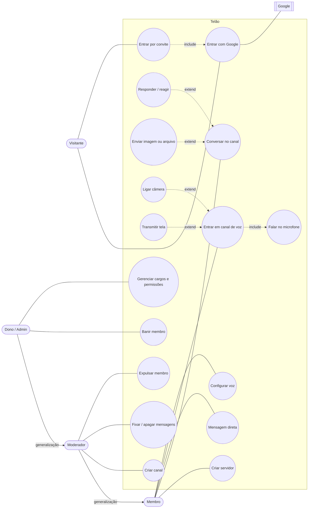
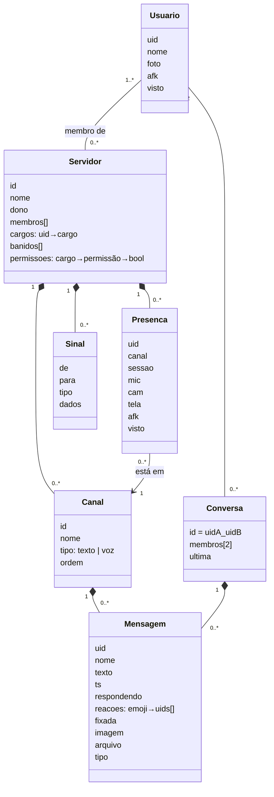
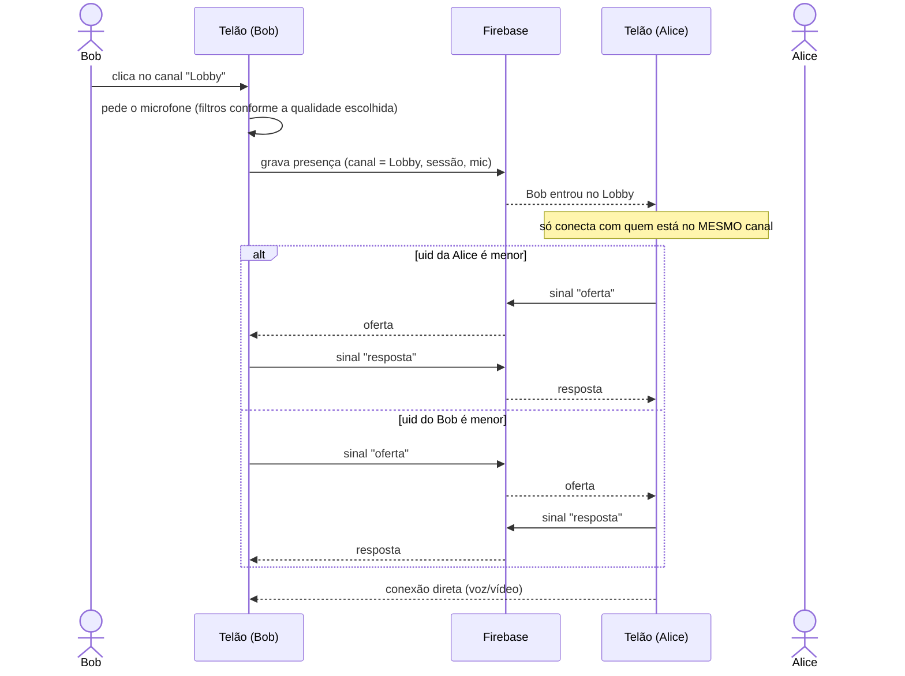
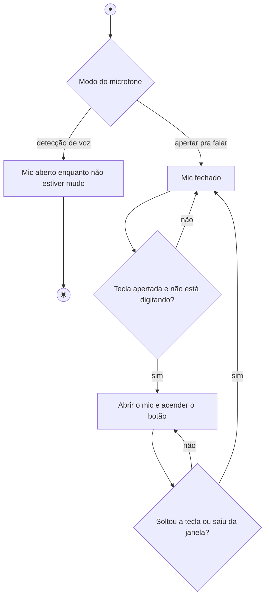

# Telão — Documento de Requisitos

**Versão:** 2.0 · **Autor:** Davi (wasmorf) · **Data:** 16/11/2026

| Versão | Data | O que mudou |
|---|---|---|
| 1.0 | 14/11/2026 | Servidores, chat único, call única, câmera e transmissão de tela. |
| 2.0 | 16/11/2026 | Canais de texto e voz, modelos de servidor, chat completo (responder, reagir, fixar, imagens e arquivos, menções), cargos e permissões, expulsar/banir, mensagens diretas, status AFK e configurações de voz (apertar pra falar, qualidade, microfone, volume por pessoa). |

## 1. Visão geral

O Telão é um site particular para um grupo de amigos conversar por texto, voz e câmera e **transmitir a tela ao vivo**. Ele surgiu porque o compartilhamento de tela do Discord ficou indisponível no Brasil em 2026.

- **Problema:** o grupo não tinha onde fazer live de tela pra assistir junto.
- **Solução:** um site gratuito, hospedado no GitHub Pages, usando Firebase (login e banco) e WebRTC (voz e vídeo direto entre as pessoas).
- **Público:** o autor e os amigos dele (não é um serviço público).

### Técnicas de elicitação usadas
- **Observação de produtos existentes (benchmarking):** estudo de como apps de voz para grupos (Discord, TeamSpeak) organizam servidores, canais, cargos e chat. Só as *funcionalidades* foram usadas como referência; o visual e a marca do Telão são próprios.
- **Análise de documentos:** listas de recursos enviadas pelo usuário (prints e textos de "Messaging & Chat", "Voice Quality" e "Server Control").
- **Entrevista não estruturada:** conversa com o usuário sobre o que faltava e o que entra nesta versão ("Tudo que eu mandei").
- **Prototipação evolutiva:** cada versão foi mostrada e ajustada (cor laranja, logo, layout mais simples, celular).

## 2. Atores

| Ator | Descrição |
|---|---|
| **Visitante** | Pessoa que abriu o site mas ainda não entrou com o Google. |
| **Membro** | Pessoa logada que faz parte de um servidor. |
| **Moderador** | Membro com permissões de moderação (por padrão: criar canais, fixar, apagar mensagens, expulsar). |
| **Admin** | Membro com todas as permissões, menos as exclusivas do dono. |
| **Dono** | Quem criou o servidor. Pode tudo. |
| **Google** (sistema externo) | Autentica as pessoas. |
| **Firebase** (sistema externo) | Guarda servidores, canais, mensagens, conversas e presença; repassa os sinais de conexão. |

Generalização: Dono → Admin → Moderador → Membro (cada um herda o que o anterior pode).

## 3. Requisitos funcionais

### Conta e servidores
| ID | Requisito | Prioridade |
|---|---|---|
| RF01 | O sistema deve permitir entrar e sair com uma conta Google. | Alta |
| RF02 | O usuário deve poder criar um servidor com nome (até 40 caracteres) e um **modelo** de canais (Gamer, Amigos, Estudos ou Simples). | Alta |
| RF03 | O sistema deve listar os servidores do usuário em qualquer aparelho. | Alta |
| RF04 | O membro deve poder copiar um link de convite do servidor. | Alta |
| RF05 | Quem abrir um convite e estiver logado deve virar membro, e o canal de texto deve mostrar "Fulano entrou no servidor". | Alta |
| RF06 | O dono deve poder renomear e excluir o servidor; os outros podem sair dele. | Média |
| RF07 | O usuário deve poder ficar **AFK** manualmente; o sistema deve marcar AFK sozinho após 10 min sem mexer. | Baixa |

### Canais
| ID | Requisito | Prioridade |
|---|---|---|
| RF08 | O servidor deve ter **canais de texto** e **canais de voz**, separados na lista. | Alta |
| RF09 | Quem tem permissão deve poder criar, renomear e apagar canais. | Alta |
| RF10 | A lista de canais deve mostrar quem está em cada canal de voz, com ícones de mudo, câmera, AO VIVO e AFK. | Alta |

### Chat
| ID | Requisito | Prioridade |
|---|---|---|
| RF11 | O membro deve poder enviar mensagens de até 2000 caracteres, com Enter para enviar e Shift+Enter para pular linha. | Alta |
| RF12 | O membro deve poder **responder** uma mensagem; a resposta mostra a original e leva até ela ao clicar. | Alta |
| RF13 | O membro deve poder **reagir** com emoji; a reação mostra a contagem e quem já reagiu fica destacado. | Média |
| RF14 | Quem tem permissão deve poder **fixar** mensagens; uma barra mostra as fixadas, com navegação entre elas. | Média |
| RF15 | O membro deve poder enviar **imagens** (comprimidas automaticamente) e **arquivos** até 700 KB, pelo botão, colando ou arrastando. | Média |
| RF16 | Links devem virar clicáveis e **@nome** / **@todos** devem destacar a mensagem para quem foi mencionado. | Média |
| RF17 | O autor deve poder apagar a própria mensagem; quem tem permissão apaga a de qualquer um. | Média |
| RF18 | Mensagens seguidas do mesmo autor (até 5 min) devem aparecer agrupadas. | Baixa |
| RF19 | O sistema deve ter um seletor de emoji com categorias, busca e recentes. | Baixa |

### Cargos e moderação
| ID | Requisito | Prioridade |
|---|---|---|
| RF20 | O servidor deve ter os cargos Dono, Admin, Moderador e Membro, com selo colorido no chat e na lista de membros. | Alta |
| RF21 | Quem pode "dar cargos" deve poder editar uma **tabela de permissões** (9 permissões × 3 cargos). | Alta |
| RF22 | Quem tem permissão deve poder **expulsar** (pode voltar com convite) e **banir** (não volta) alguém de cargo menor. | Alta |
| RF23 | Quem pode banir deve ver a lista de banidos e poder **desbanir**. | Média |
| RF24 | A lista de membros deve agrupar por cargo e status (online, AFK, offline) e mostrar quem está em voz. | Média |

### Mensagens diretas
| ID | Requisito | Prioridade |
|---|---|---|
| RF25 | O usuário deve poder conversar em privado com qualquer pessoa que esteja num servidor com ele. | Alta |
| RF26 | O sistema deve avisar quando houver mensagem direta não lida. | Média |

### Voz, câmera e tela
| ID | Requisito | Prioridade |
|---|---|---|
| RF27 | Clicar num canal de voz deve conectar o usuário a ele; a call continua ao navegar por outros canais e servidores. | Alta |
| RF28 | O usuário deve poder mutar o microfone e **ensurdecer**. | Alta |
| RF29 | O usuário deve poder escolher **detecção de voz** ou **apertar pra falar** (tecla configurável). | Média |
| RF30 | O usuário deve poder escolher a **qualidade do áudio**: Voz (com redução de ruído e eco) ou Música (alta qualidade, estéreo, sem filtros). | Média |
| RF31 | O usuário deve poder escolher qual microfone usar. | Média |
| RF32 | O usuário deve poder ajustar o **volume de cada pessoa**. | Média |
| RF33 | O usuário deve poder ligar a câmera e **transmitir a tela com som**, escolhendo 720p30, 1080p30 ou 1080p60. | Alta |
| RF34 | O sistema deve mostrar quem está falando, mudo, com câmera e ao vivo. | Média |

## 4. Requisitos não funcionais

| ID | Tipo | Requisito |
|---|---|---|
| RNF01 | Custo | Deve funcionar 100% no plano gratuito do GitHub Pages e do Firebase. |
| RNF02 | Portabilidade | Deve funcionar em Chrome, Edge, Firefox, Safari, Opera e Samsung Internet, no PC, Android e iPhone. |
| RNF03 | Usabilidade | No celular, a tela deve virar 3 abas (Canais, Conversa, Membros). |
| RNF04 | Desempenho | Voz e vídeo devem ir direto entre as pessoas (sem servidor de vídeo), com atraso baixo. |
| RNF05 | Segurança | Todas as permissões devem ser checadas também no banco (regras do Firestore), não só na tela. |
| RNF06 | Privacidade | Mensagens diretas só podem ser lidas pelas duas pessoas da conversa. |
| RNF07 | Manutenibilidade | HTML semântico, um CSS externo organizado em seções, módulos JavaScript pequenos (um assunto por arquivo). |
| RNF08 | Acessibilidade | Imagens com `alt`, campos com `label`, botões com rótulo, navegação por teclado. |
| RNF09 | Identidade | Visual próprio do Telão (laranja e escuro, logo própria); não copiar visual nem marca de outros apps. |

## 5. Regras de negócio

- **RN01** — O dono sempre pode tudo e não pode ser expulso, banido nem rebaixado.
- **RN02** — Ninguém age (cargo, expulsar, banir) sobre alguém de cargo **igual ou maior** que o seu.
- **RN03** — Quem tem o convite entra no servidor, **exceto banidos**.
- **RN04** — Uma pessoa só está em **um canal de voz por vez**; entrar em outro sai do anterior.
- **RN05** — Se uma pessoa não der sinal por 35 segundos, ela some do canal de voz.
- **RN06** — O chat carrega as últimas 100 mensagens de cada canal ou conversa.
- **RN07** — Imagens são reduzidas para no máximo 1280 px; arquivos têm limite de 700 KB (limite de 1 MB por documento do Firestore).
- **RN08** — Transmitir a tela só é possível no computador (limitação dos navegadores de celular).
- **RN09** — Permissões padrão:

| Permissão | Admin | Moderador | Membro |
|---|:-:|:-:|:-:|
| Criar canais | ✔ | ✔ | |
| Editar e apagar canais | ✔ | | |
| Fixar mensagens | ✔ | ✔ | |
| Apagar mensagens dos outros | ✔ | ✔ | |
| Enviar imagens e arquivos | ✔ | ✔ | ✔ |
| Transmitir tela | ✔ | ✔ | ✔ |
| Expulsar membros | ✔ | ✔ | |
| Banir membros | ✔ | | |
| Dar cargos e mudar permissões | ✔ | | |

## 6. Casos de uso

- **«include»:** entrar por convite **sempre** passa pelo login; entrar no canal de voz **sempre** liga o microfone.
- **«extend»:** responder, reagir e anexar são **opcionais** dentro da conversa; câmera e tela são opcionais dentro do canal de voz.
- Os casos do Moderador e do Admin dependem das permissões da tabela (RN09) — o dono pode mudá-las.

### UC16 — Banir membro (descrição)

| Campo | Conteúdo |
|---|---|
| **Ator** | Membro com a permissão "Banir membros" |
| **Pré-condições** | Estar logado, no servidor, e o alvo ter cargo menor que o seu (RN02). |
| **Pós-condições** | O alvo sai da lista de membros, entra na lista de banidos e não consegue voltar pelo convite. |

**Fluxo principal**
1. O ator clica no nome do alvo na lista de membros.
2. O sistema mostra o menu com as ações que o ator pode fazer.
3. O ator escolhe **Banir**.
4. O sistema pede confirmação.
5. O ator confirma; o sistema remove o alvo e o adiciona aos banidos.
6. O servidor some da lista do alvo (e ele sai da call, se estiver).

**Fluxos alternativos**
- **A1 — Sem permissão:** a opção Banir não aparece no passo 2; mesmo se forçada, o banco recusa (RNF05).
- **A2 — Cancelou no passo 4:** nada muda.
- **A3 — Banido tenta voltar pelo convite:** o banco recusa e o site avisa "Você foi banido desse servidor".
- **A4 — Desbanir:** em Configurações → Banidos, o ator clica em **Desbanir**; a pessoa pode voltar pelo convite.

### UC11 — Transmitir tela (descrição)

| Campo | Conteúdo |
|---|---|
| **Ator** | Membro com a permissão "Transmitir tela" |
| **Pré-condições** | Estar num canal de voz e usar um computador. |
| **Pós-condições** | Todos no canal veem a tela do ator no topo do palco, com a marca AO VIVO. |

**Fluxo principal**
1. O membro escolhe a qualidade (opcional) e clica em **Transmitir**.
2. O navegador pergunta o que compartilhar e se inclui o áudio.
3. O membro escolhe e confirma.
4. O sistema envia a tela para cada pessoa do canal e marca o membro como AO VIVO.

**Fluxos alternativos**
- **A1 — Cancelou no passo 3:** nada muda.
- **A2 — Celular:** o botão Transmitir não aparece (RN08).
- **A3 — Cargo sem permissão:** o site avisa "Seu cargo não pode transmitir neste servidor".

## 7. Diagrama de classes (modelo de dados)

Canais, presenças e sinais são **composição** do servidor: se o servidor for excluído, eles deixam de existir para o app. A mesma classe Mensagem é usada em canais e em conversas diretas.

## 8. Diagrama de sequência — entrar num canal de voz

## 9. Diagrama de atividades — apertar pra falar

## 10. Rastreabilidade (requisito → onde está no código)

| Requisito | Arquivo |
|---|---|
| RF01 | `js/auth.js` |
| RF02–RF06 | `js/servidores.js`, `js/membros.js` (configurações) |
| RF07 | `js/perfis.js` |
| RF08–RF10 | `js/canais.js` |
| RF11–RF18 | `js/chat.js`, `js/util.js` (links e menções) |
| RF19 | `js/emoji.js` |
| RF20–RF24 | `js/permissoes.js`, `js/membros.js` |
| RF25, RF26 | `js/dm.js` |
| RF27 | `js/call.js` |
| RF28–RF31, RF33 | `js/midia.js`, `js/rtc.js` |
| RF32, RF34 | `js/palco.js`, `js/fala.js` |
| RNF02, RNF03 | `js/compat.js`, `css/style.css` (seção 13) |
| RNF05, RNF06, RN01–RN03 | `firestore.rules` |
| RN09 | `js/config.js` (`PERMISSOES_PADRAO`) e `firestore.rules` (`padrao`) |
